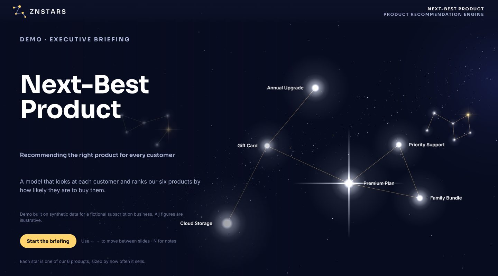
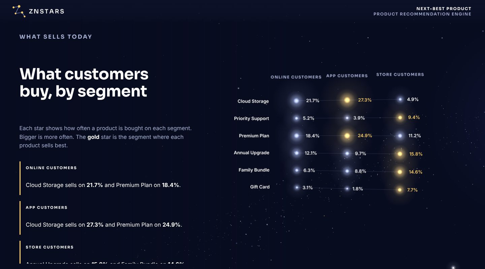
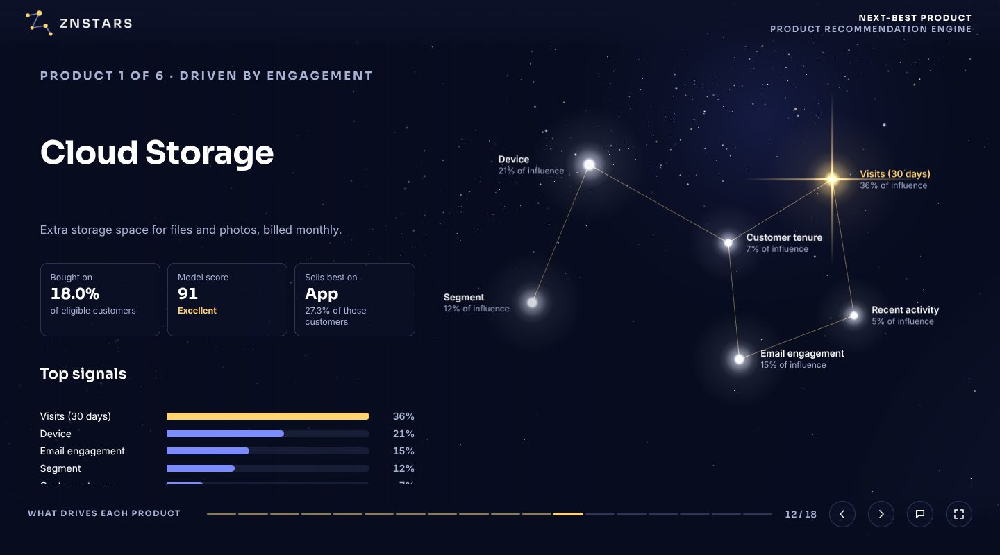

# Constellation Slides

Turn a machine learning model's output folder into a presentation leadership actually reads:
an interactive 3D "night sky" briefing where every product is a star and every product's drivers form
its own constellation. The same run also produces a static slide deck that exports to PowerPoint or PDF.

It's a [Claude](https://claude.ai) skill. Point Claude at a model output folder, say who the audience is,
and it writes the story, builds the deck and publishes it.



| | |
|---|---|
|  |  |

## What you get

- **Two audiences from one run.** *Exec* decks speak plain language ("our #1 suggestion was bought 48% of
  the time"); *analyst* decks show P@1, R@3, NDCG@3, AUC, within-group AUC and SHAP values.
- **Every number from the data, every sentence editable.** Figures come straight from the model's CSVs;
  all wording lives in one `story.json`.
- **A full deck, built automatically:** the bottom line, how it works, uptake by segment, model vs.
  baselines, generalisation across folds, group vs. customer share, a sortable report card, a driver map,
  driver families, one slide per product and a close with takeaways and next steps. Slides whose inputs are
  missing are skipped.
- **Interactive:** hover any star for its value, speaker notes (`N`), full screen, SHAP beeswarm drawer for
  analysts, keyboard navigation.
- **Your brand.** One theme file sets the logo, colours and fonts. ZNSTARS is the default.

## Try the demo

The `examples/` folder has a complete synthetic run for a fictional subscription business (six products,
three segments, all folds, SHAP charts).

```bash
python examples/make_demo_data.py            # regenerate the synthetic model output (optional)
python scripts/build_threejs.py examples/demo_model_output --story examples/demo_story.json --out demo/index.html
python -m http.server 8000                   # then open http://127.0.0.1:8000/demo/index.html
```

Python 3.11+ with the standard library is all the builders need (Pillow only for drawing the demo's charts).

## Your own model

The builders read a folder with `rate_by_segment_pct.csv` (required) plus, optionally, `metrics_summary.csv`,
per-label metrics and SHAP outputs. The full list of files and columns is in
[`references/data-contract.md`](references/data-contract.md).

```bash
python scripts/init_story.py <model_dir> --audience exec --out story.json   # starter story + data summary
# edit story.json: product names, descriptions, "more likely to buy when..." bullets, next steps
python scripts/build_threejs.py <model_dir> --story story.json --out deck/index.html   # add --standalone to host it on a website
python scripts/build_deck.py <model_dir> --story story.json --root slides   # static deck (PPTX/PDF route)
```

## Client branding

Copy `assets/theme.json`, change the colours, fonts and logo path, and pass it to either builder:

```bash
python scripts/build_threejs.py <model_dir> --story story.json --out deck/index.html --theme acme/theme.json
```

Any key you leave out falls back to the ZNSTARS theme. See "Themes" in [`SKILL.md`](SKILL.md) for what each
colour controls.

## Using it with Claude

Install it in Claude Code (2.1.275 or later):

```
/plugin install constellation-slides --marketplace jzhng105/actskill-constellation-slides
```

On older versions, run `/plugin marketplace add jzhng105/actskill-constellation-slides`, then `/plugin install constellation-slides@znstars`.
You can also copy this repository into your skills folder as a plain skill.

Then ask for "slides", "a briefing" or "a constellation view" of your model results. [`SKILL.md`](SKILL.md) is the workflow Claude follows; `references/` holds the data contract, the
copywriting guide for each audience, and the steps for the Slides deck.

---

Built by ZNSTARS. Free to use under the [Boost Software License 1.0](LICENSE).
